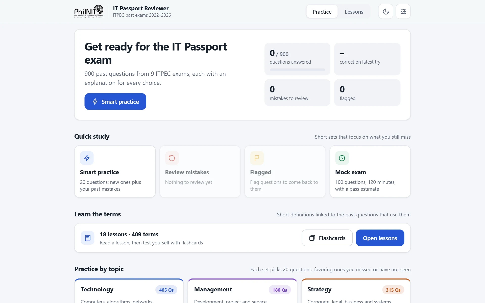
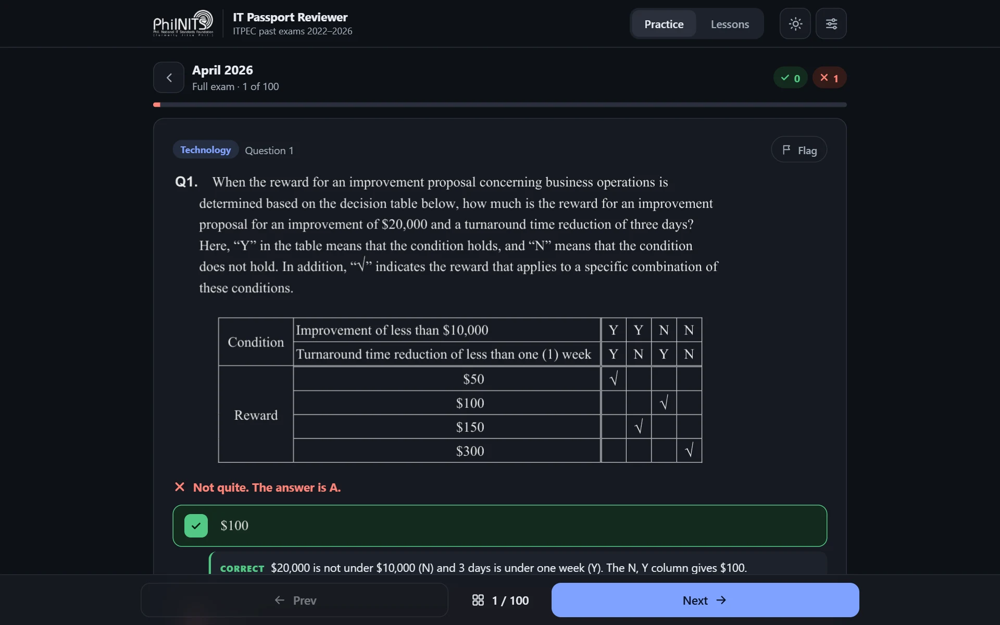
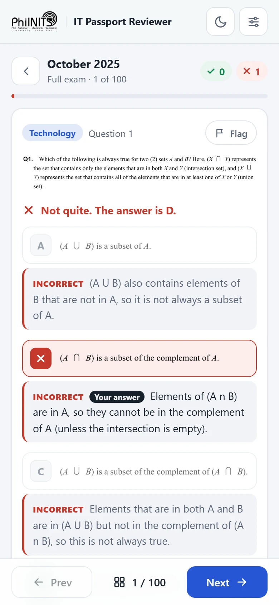
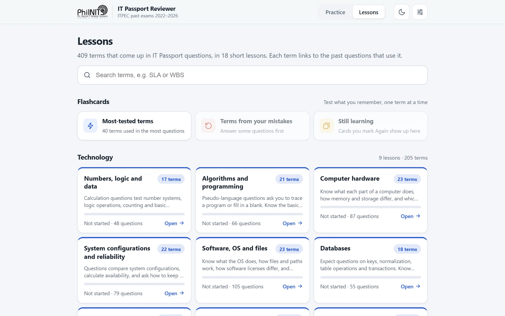
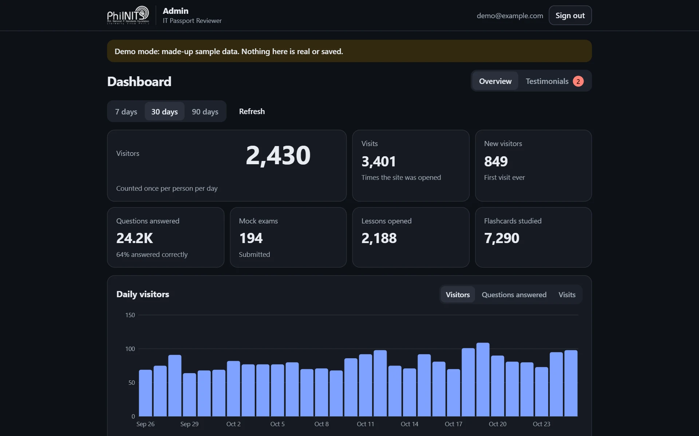

<div align="center">

# IT Passport Reviewer

**Free practice for the ITPEC IT Passport (IP) exam: 900 past questions, with an explanation for every answer choice.**

### [Open the reviewer →](https://mynameisrinax.github.io/philnits-reviewer/)

[](https://github.com/MyNameIsRinax/philnits-reviewer/actions/workflows/static.yml)
[](https://github.com/MyNameIsRinax/philnits-reviewer/actions/workflows/import-exams.yml)



</div>

## Why use it

- **Every exam since 2022.** All April and October papers, 100 questions each, with the official answer keys. New exams are added automatically when ITPEC publishes them.
- **Explanations for all four choices**, not just the right one, so you also learn why the other answers are wrong.
- **Made for fast review.** Short focused sets, a timed mock exam, and a mistakes list that clears as you get questions right.
- **Lessons and flashcards** for 409 key terms, each linked to the past questions that use it.
- **Works on any device**, in light or dark mode. No account needed: your progress is saved in your browser.

<table>
  <tr>
    <td width="77%"></td>
    <td width="23%"></td>
  </tr>
</table>

## Ways to study

| Mode | What it does |
| --- | --- |
| **Smart practice** | 20 questions mixing ones you have not seen with your past mistakes |
| **Review mistakes** | Every question whose latest answer was wrong. Answer it right to clear it |
| **Flagged** | Questions you flagged to come back to |
| **Practice by topic** | Technology, Management or Strategy |
| **Past exams** | A full paper in order, with a results page at the end |
| **Mock exam** | 100 questions and a 120-minute timer. Answers stay hidden until you submit, then you get a pass estimate (60% overall and at least 30% in each topic) |
| **Custom set** | Pick the exams, topics and number of questions |

### Lessons and flashcards



- 18 short lessons covering 409 terms across Technology, Management and Strategy, each with a plain-language definition and tips for terms that are easy to mix up.
- Every term shows how many past questions use it, and can start a practice set of them.
- Flashcards for each lesson, plus decks for the most-tested terms, terms from questions you missed, and cards you marked "Again".
- After you answer a question, its key terms appear as chips. Tap one to see what it means.

### While answering

- Every choice shows an explanation once you answer.
- Tap the question image to enlarge it. Images follow the light or dark theme.
- **Shuffle answer choices** (in Settings) reassigns the letters A–D, so you remember the answer, not its position.

| Key | Action |
| --- | --- |
| <kbd>A</kbd>–<kbd>D</kbd> or <kbd>1</kbd>–<kbd>4</kbd> | Answer |
| <kbd>Enter</kbd> | Next question |
| <kbd>←</kbd> / <kbd>→</kbd> | Previous / next question |
| <kbd>F</kbd> | Flag the question |
| <kbd>G</kbd> | Open the question list |

## Exams included

| Year | April | October |
| :---: | :---: | :---: |
| 2026 | ✓ | Added automatically when ITPEC publishes it |
| 2025 | ✓ | ✓ |
| 2024 | ✓ | ✓ |
| 2023 | ✓ | ✓ |
| 2022 | ✓ | ✓ |

**Notes on the answer keys**

- **October 2025 Q42:** the official key lists "Reinstalling the web browser". This reviewer marks "Cutting off connection with the wireless LAN, and isolating the PC" as correct, since that is the standard first step. The explanation mentions the difference.
- **April 2026 Q64 and Q71:** the PDF misprints their choice letters (e.g. "e)"). The choices are shown in printed order as A–D.

---

## Running the site

It is a static site with no build step. Serve the folder with any web server and open it:

```bash
python -m http.server 8000
```

Then go to http://localhost:8000. Every push to `main` redeploys GitHub Pages (`.github/workflows/static.yml`).

## Automatic exam import

The **Import new ITPEC exams** workflow runs every day at 09:00 Philippine time. It checks [itpec.org/pastexamqa/ip.html](https://itpec.org/pastexamqa/ip.html) for exams the site does not have yet (for example `2026A_IP.zip` for October 2026), crops each question into `img/<exam>/`, adds the exam and its answer key to `data.js`, commits, and redeploys the site. GitHub Actions is free for public repositories, so this costs nothing.

### Free AI explanations with Gemini

Explanations are written by Google's Gemini API on its free tier: no credit card, no bill.

1. Open [aistudio.google.com/apikey](https://aistudio.google.com/apikey), sign in with a Google account and click **Create API key**. If it asks for a project, pick or create one **other than** the Firebase project (see [Security notes](#security-notes)).
2. In this repository, go to **Settings → Secrets and variables → Actions → New repository secret**. Name it `GEMINI_API_KEY` and paste the key as the value.
3. Optional: **Actions → Import new ITPEC exams → Run workflow** to try it right away.

How it behaves:

- **No key, or a key that stopped working?** Exams are still added, and their explanations show "Explanation coming soon". Every run fills in missing explanations for any exam (up to 150 questions per run), so adding or replacing the key later catches up by itself.
- **Limits.** The free tier has daily and per-minute limits ([see yours](https://aistudio.google.com/rate-limit)). The importer paces itself, and anything left over is finished on the next day's run.
- **Models.** It uses `gemini-flash-latest`, which always points to Google's current Flash model, and falls back to other free Flash models when one is busy or retired. To change the list, add a repository **variable** named `GEMINI_MODELS`, e.g. `gemini-flash-latest,gemini-3.5-flash-lite`.
- **Privacy.** Google may use free-tier requests to improve its products. The requests contain only the public exam questions.
- **Staying switched on.** GitHub turns off scheduled workflows after 60 days without repository activity. To prevent that, the workflow updates `tools/last-check.txt` once a month when nothing else changed.
- **Things to check.** Each run's summary lists anything worth a look: questions shown as one image with A–D buttons (when the choice labels could not be found), and answers the AI thinks the official key may have wrong.

To run the import on your own computer:

```bash
pip install -r tools/requirements.txt
```

```bash
python tools/import_exams.py --dry-run
```

`--dry-run` only lists new exams. Run it without the flag to import them (set `GEMINI_API_KEY` for explanations), or add `--no-explain` to import without calling the AI.

## Testimonials, visitor stats and admin panel

These run on Firebase's free Spark plan. Until `firebase-config.js` is filled in, the site works as usual without them.

- **Testimonials.** Visitors can share their story from the home page. Stories wait in the admin panel, and only the ones you publish appear in the carousel. To ask people for a story, send them [`/#/share`](https://mynameisrinax.github.io/philnits-reviewer/#/share): it opens the site with the story form already showing.
- **Visitor stats.** Visits are counted anonymously per day: visitors, new visitors, devices, where visitors came from, busiest hours, questions answered and % correct, mock exams, lessons and flashcards. Google Analytics adds countries, browsers and real-time visitors.
- **Admin panel** at [`/admin.html`](https://mynameisrinax.github.io/philnits-reviewer/admin.html) (sign in with Google). Preview it with made-up data at [`admin.html?demo=1`](https://mynameisrinax.github.io/philnits-reviewer/admin.html?demo=1).



### One-time Firebase setup

1. In the [Firebase console](https://console.firebase.google.com), create a project with Google Analytics turned on. Stay on the free **Spark** plan: it has no billing account, so it can never charge you.
2. **Project Overview → Add app → Web.** Copy the `firebaseConfig` values into `firebase-config.js`.
3. **Firestore Database → Create database.** Pick a location near your visitors (`asia-southeast1`, Singapore, for the Philippines; it cannot be changed later) and start in production mode.
4. **Firestore Database → Rules.** Replace everything with the contents of [`firestore.rules`](firestore.rules) and click **Publish**.
5. **Authentication → Get started → Sign-in method → Google → Enable.** Then **Authentication → Settings → Authorized domains → Add domain:** `mynameisrinax.github.io`
6. Push, open the admin panel on the live site and sign in. It shows your user ID. Put it in the list of admin user IDs in `firestore.rules` (in `isAdmin()`), both here and in the console's Rules tab, then publish again. To add another admin, add their user ID to the same list.

**Free limits:** 50,000 reads and 20,000 writes per day, and 1 GiB of storage. A visit uses about 1–3 writes (counts are saved every 3 minutes and when the tab closes) and at most one read every 30 minutes for testimonials, so several thousand visits a day fit. If a day's limit is ever reached, counting pauses until the next day and the reviewer keeps working.

## Security notes

This repository is public. That is fine, because:

- **`firebase-config.js` is meant to be public.** Every Firebase website sends these values to the browser anyway. The Firestore rules decide who can read or change data, and this key is already limited to Firebase services. GitHub may still flag it as an exposed Google API key; you can dismiss that alert.
- **The Gemini key is never in the code.** It lives only in the repository's secrets, which GitHub hides from everyone, including people who fork the repository.
- **Keep the Gemini API out of the Firebase project.** If Gemini were turned on in the same Google Cloud project, the public Firebase key could be used to spend your free Gemini quota. A separate project avoids that.
- **Visitors can only add.** The rules let anyone send a story or add small amounts to the daily counters. Only admins can read stories, publish them or see the stats. Someone could still script junk stories or inflate a counter. It cannot cost money, and nothing appears on the site without your approval. If it ever becomes a problem, turn on [Firebase App Check](https://firebase.google.com/docs/app-check).
- **Your user ID in `firestore.rules` is not a password.** It only names who the admin is. Signing in still needs your Google account.

## Project structure

```text
index.html, style.css, app.js   the reviewer
data.js                         answers, topics and explanations
lessons.js                      lesson text and term definitions
img/                            question and choice images, one folder per exam
firebase-config.js              Firebase web config (empty = Firebase features off)
cloud.js                        visit counting, Google Analytics and testimonials
admin.html, admin.js            admin panel
firestore.rules, firebase.json  database security rules
tools/                          exam importer (import_exams.py, crop_exam.py)
docs/screenshots/               images for this README
.github/workflows/              GitHub Pages deploy and the daily exam import
```

## Credits

Made by **Rinax Antonio**. This is an independent reviewer, not affiliated with PhilNITS or ITPEC.

The past exam questions and answer keys come from ITPEC's public archive at [itpec.org/pastexamqa](https://itpec.org/pastexamqa/ip.html). All rights to them belong to their owners.
